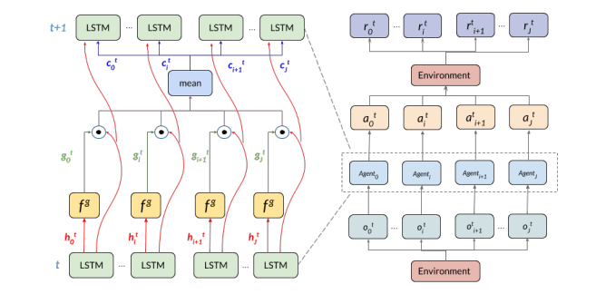
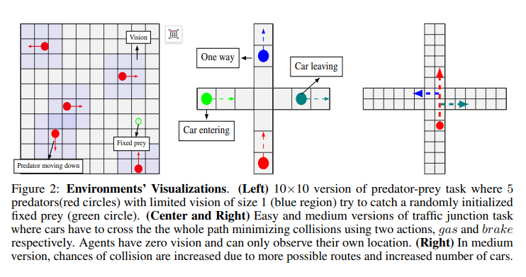
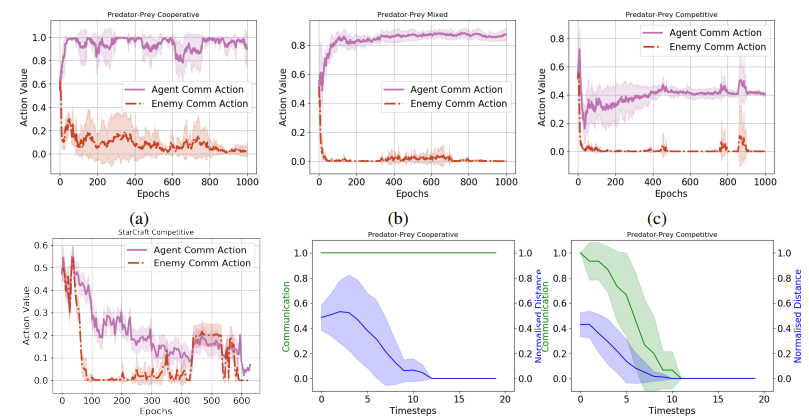
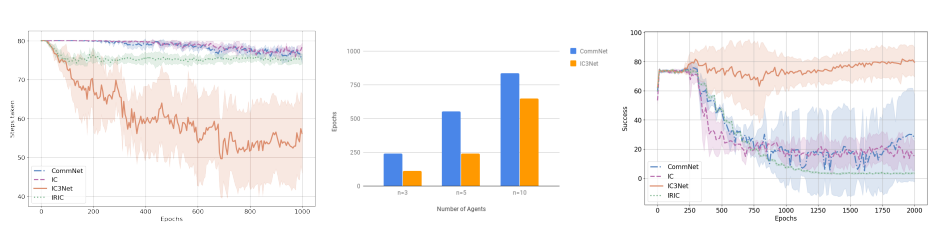

# Cognitive Radio: Learning Communication Timing in Large-Scale Multi-Agent Collaborative and Competitive Tasks [with Python Code]

In multi-agent tasks, learning when to communicate and how to communicate effectively is crucial. Recent studies have shown that continuous communication can make backpropagation training more efficient in multi-agent scenarios, but such methods are limited to fully cooperative tasks. This paper proposes a personalized controllable continuous communication model (IC3Net), which outperforms simple continuous communication models in terms of training efficiency and is applicable to semi-cooperative, competitive, and cooperative scenarios. IC3Net controls continuous communication through a gating mechanism and uses personalized rewards for each agent to enhance performance and scalability while addressing the issue of credit assignment. Through experiments in multiple tasks including "StarCraft" exploration and combat scenarios, we demonstrate that as the scale expands, the network's performance and convergence speed surpass baseline models. The study results show that IC3Net agents can learn about communication timing based on the scenario and profitability.
Communication is a fundamental aspect of intelligence, facilitating learning from others' experiences, better team collaboration, and knowledge transfer. In multi-agent scenarios, communication enables agents to collaborate towards a common goal. Especially in partially observable environments, where agents observe different parts of the environment, they can share their observations and learning outcomes through communication.
In recent years, reinforcement learning (RL) has achieved great success in single-agent domains, from playing Atari games to playing Go, but most remain confined to single-agent settings. However, the number of multi-agent systems and applications is growing, ranging from robot teams in manufacturing factories to autonomous driving car networks. Therefore, extending the success of RL to multi-agent environments is crucial for building smarter systems with higher productivity. Additionally, research into scenarios other than cooperation, namely semi-cooperative (or mixed) and competitive scenarios, in multi-agent systems is still not deep enough.
Mixed scenarios are similar to most real-life settings, where humans collaborate but not fully cooperate. While individuals strive for personal goals, they also work together. In competitive scenarios, agents essentially compete for better rewards. In real life, humans have the option of communication at any time, but can decide when to engage in actual communication. For example, in sports competitions, teams that can communicate might choose not to communicate (to prevent strategic leakage) or use dishonest signals (to mislead opponents), thereby optimizing their own rewards and hindering their opponents, making the timing of learning communication crucial.
Teaching agents how to communicate eliminates the need for manual protocol writing based on expert knowledge. While the content of communication is important, knowing when to communicate is equally crucial, which enhances scalability and performance and strengthens competitive advantages. For instance, prey need to learn when to communicate to avoid revealing their location to predators.
Sukhbaatar et al. (2016) show that agents trained through continuous vector communication are easier to train than those based on discrete symbols and achieve higher information throughput. Their continuous communication is differentiable, allowing efficient training via backpropagation. However, this model assumes full cooperation among agents and uses average global rewards. This limits its application in mixed or competitive scenarios, as full cooperation requires sharing hidden states with all agents, which exposes all information. As our results show, this leads to poor performance across all agents. Moreover, the average global reward for all agents makes the credit assignment problem more challenging and difficult to scale, as in mixed or competitive scenarios, agents want to succeed before others but cannot know their individual contributions.
To address these issues, we make the following contributions:
We propose a personalized controllable continuous communication model (IC3Net), where each agent is trained through personalized rewards, applicable to any scenario including collaboration.
Empirical evidence demonstrates that our model, based on a given scenario, learns to time its communication through a gating mechanism. This gating mechanism allows the agent to block its own communication, which is useful in competitive scenarios. 
Experiments conducted in three selected environments, including "StarCraft," at different scales show that IC3Net outperforms baseline models, with performance gaps increasing as the scale expands. The results indicate that individual rewards converge faster and more effectively than global rewards. 
Figure: 
Conclusion In this paper, we propose IC3Net, aiming to solve the task of multi-agent cooperation in various collaborative scenarios by learning to time their communications. Its continuous communication is efficiently trained through backpropagation, while discrete gating combined with individual rewards trained through reinforcement learning makes it applicable across all scenarios and scalable to larger scales. 
Through experiments, we show that IC3Net performs well in cooperative, mixed, or competitive scenarios, and only learns to communicate when necessary. Additionally, we demonstrate that agents learn to stop communicating in competitive scenarios. Further experiments reveal the network's scalability. In the future, we hope to explore the possibility of multi-channel communication, allowing agents to decide which channel to transmit information on, similar to communication groups but dynamic. Allowing agents to choose whether to listen to a certain channel's communication would also be an interesting research direction. 
End

## Images

<!-- PAYMENT_BLOCK -->

## Get this dataset

- Payment link (Stripe): [Buy now](https://buy.stripe.com/3cs8yP7sY87d0vu9AB)
- Payment QR code: 

<!-- /PAYMENT_BLOCK -->
